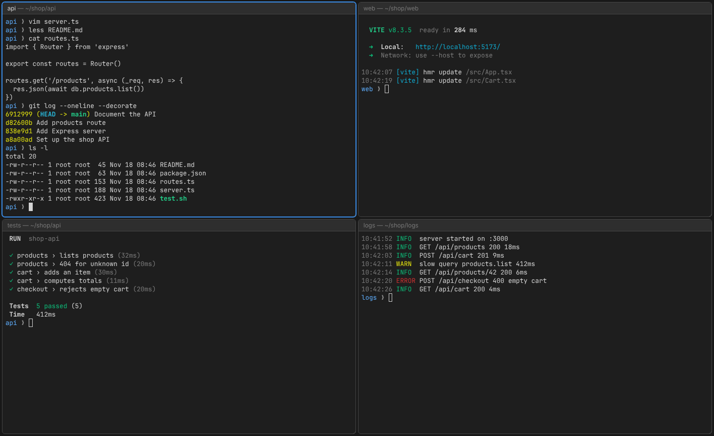
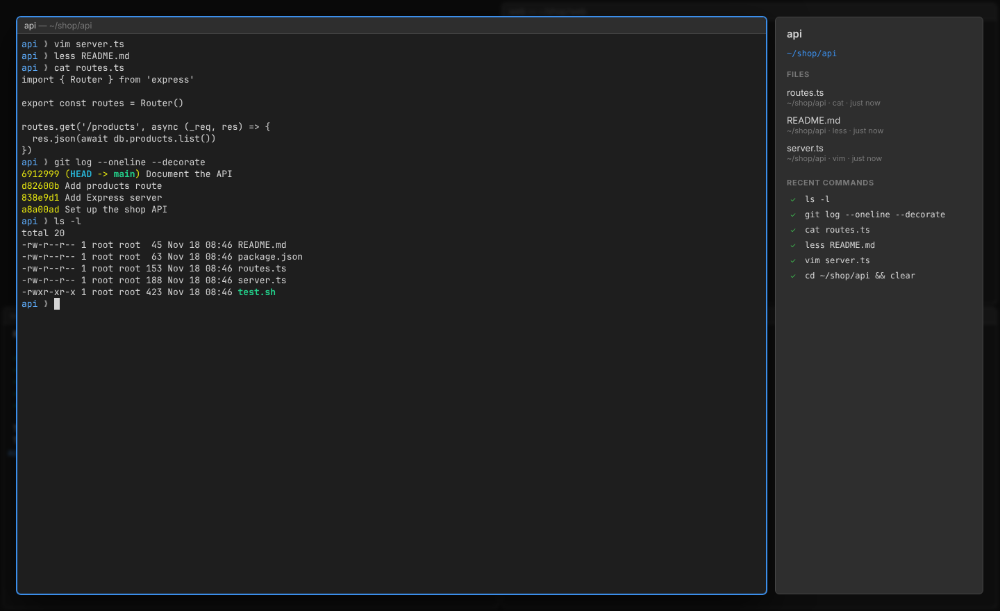

# Grid Shell

[](https://github.com/aiah123/grid-shell/actions/workflows/ci.yml)

Grid Shell is a terminal for macOS and Linux that keeps all your shell sessions in view at once. Sessions share the window as an even grid, so you can watch a dev server, logs and tests side by side, then step into any one of them when you need to focus.



Double-click a session (or press Cmd+Enter / Ctrl+Shift+Enter) to focus on it. It fills most of the window, next to a Context panel showing its folder, the files you've opened in it and its recent commands. Click anywhere outside it to go back to the grid.



**What it does:**
- **Every session in view:** sessions split the window evenly. Drag the borders between them to resize; double-click a border to make them equal again.
- **Named sessions:** double-click a title bar to rename a session. Move between sessions with a click or the keyboard.
- **Focus mode and context:** see the files opened in a session, preview them with syntax highlighting, and re-run recent commands.
- **Your own shell:** bash, zsh or any other shell, with its history, tab completion and settings.
- **Picks up where you left off:** session names, folders and context come back when you reopen Grid Shell.
- **Make it yours:** 9 themes (or import iTerm2 themes), fonts, and every shortcut can be changed.

## Running from source
Grid Shell isn't packaged as an app; run it from the code. It works on macOS and Linux.

**You need:**
- [Node.js](https://nodejs.org) 20 or newer, with npm
- **Linux:** a C/C++ toolchain, because the terminal module (`node-pty`) is compiled on install:
  - Debian/Ubuntu: `sudo apt install build-essential python3`
  - Fedora: `sudo dnf install gcc-c++ make python3`
- **macOS:** nothing extra. `node-pty` ships prebuilt for Intel and Apple Silicon. If its install ever falls back to compiling, install the Xcode Command Line Tools with `xcode-select --install`.
- zsh or bash for directory, command and file tracking. Other shells work without it.

**Then:**
```bash
git clone https://github.com/aiah123/grid-shell.git
cd grid-shell
npm install
npm start
```

`npm start` builds the app and opens it. To update, run `git pull`, then `npm install` and `npm start` again.

If `npm install` fails while building `node-pty`, check that the toolchain above is installed, then run `npm install` again.

## Development
```bash
npm run dev        # run with hot reload
npm test           # unit tests
npm run typecheck
npm run build && npm run test:e2e:all   # all end-to-end suites (use xvfb-run -a on headless Linux)
npm run build && npm run screenshots    # regenerate the README screenshots
```

CI runs on Linux and macOS for each push and pull request: a dependency audit (it fails on high or critical issues in what ships in the app, and only warns about build and test tools), the type check, the unit tests and every end-to-end suite.

## Shortcuts
| Action | macOS | Linux |
|---|---|---|
| New session | Cmd+T | Ctrl+Shift+T |
| Close session | Cmd+W | Ctrl+Shift+W |
| Rename session | Cmd+R | Ctrl+Shift+R |
| Toggle focus mode | Cmd+Enter | Ctrl+Shift+Enter |
| Move between sessions | Cmd+Option+Arrows | Ctrl+Alt+Arrows |
| Jump to session 1–9 | Cmd+1…9 | Alt+1…9 |
| Copy / Paste | Cmd+C / Cmd+V | Ctrl+Shift+C / Ctrl+Shift+V |
| Text size (active session) | Cmd+= / Cmd+- / Cmd+0 | Ctrl+Shift+= / Ctrl+Shift+- / Ctrl+Shift+0 |
| Find in session | Cmd+F | Ctrl+Shift+F |
| Settings | Cmd+, | Ctrl+Shift+, |

You can change any of these in the settings screen or in `config.toml`.

Mouse:
- Click a tile to make it active. Only the active tile receives your typing.
- Drag the border between two sessions to resize them. Each row is sized on its own; drag the border between rows to change their heights. Double-click a border to make the sizes equal again. Adding or closing a session resets the sizes.
- Double-click a title bar to rename that session. Enter saves, Esc cancels.
- Double-click a terminal to enter focus mode. Clicking anywhere outside the focused session exits focus mode; it doesn't change the active session.

- Cmd+click (macOS) or Ctrl+click (Linux) a web link in the terminal to open it in your browser.

History, tab completion and the rest come from your own shell.

## Sessions are kept between launches
When you quit, Grid Shell saves each session's name, folder and Context panel, plus the window's size and position. They come back the next time you open Grid Shell. Running programs can't be restored, so each session starts a fresh shell in its saved folder. If that folder no longer exists, the session starts in your home folder.

If a command is still running when you quit, Grid Shell asks first. Exiting the last shell closes the window and starts fresh next time. You can turn both off under Settings → Terminal → Startup and quit.

## Settings
Settings live in `~/.config/grid-shell/config.toml`. Changes apply as soon as you save the file. You can also use the settings screen (Cmd+, / Ctrl+Shift+,) to:
- pick from 9 built-in themes, or import iTerm2 themes
- set the font, cursor, opacity and spacing
- set scrollback, copy on select and the bell
- choose the shell
- record new shortcuts

See [docs/config.md](docs/config.md) for every setting.

## Context panel
In focus mode, the panel next to the session shows:
- **Current directory** (also shown in each tile's title bar).
- **Files** opened in the session. Two sources feed this list:
  - commands such as `vim`, `nvim`, `nano`, `less`, `cat`, `bat`, `tail` and `code`
  - files held open by whatever is running in the session, marked *detected*

  Click a file to preview it, with syntax highlighting in your theme's colours. Hover over a file for:
  - **Edit:** types `$EDITOR <file>` into the terminal without running it
  - **Reveal:** shows the file in your file manager
  - **×:** removes it from the list
- **Recent commands** with their exit status. Click one to type it into the terminal again.

This needs Grid Shell's shell integration, which loads automatically for zsh and bash. Your own startup files still load first. See [resources/shell-integration](resources/shell-integration/README.md). Other shells still work, but only *detected* files are listed for them.
